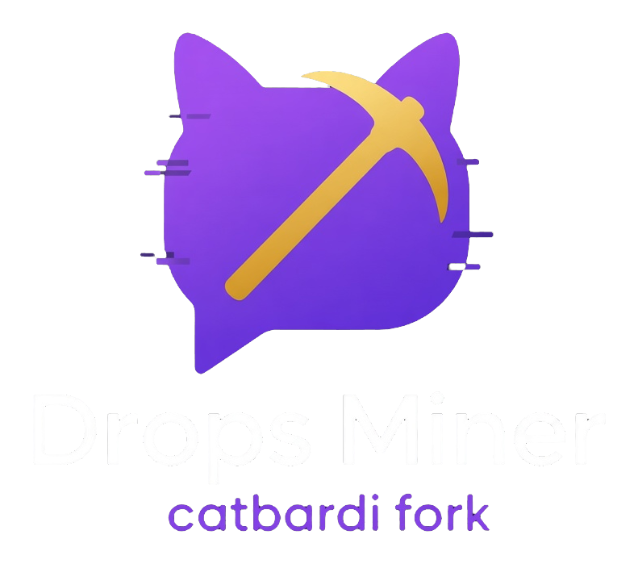

<p align="center">
  
</p>

<h1 align="center">Drops Miner (catbardi fork)</h1>

<p align="center">
  Программа сама «смотрит» нужные трансляции Twitch и забирает временные Drops — без видео и без звука.<br>
  Эта страница — про <b>версию с новым дизайном</b> (ветка <code>fork/custom-ui-quiet-journal</code>).
</p>

<p align="center">
  <a href="https://github.com/catbardi/TwitchDropsMiner/tree/fork/custom-ui-quiet-journal">Эта ветка</a> ·
  <a href="https://github.com/catbardi/TwitchDropsMiner/tree/master">Стабильный master</a> ·
  <a href="https://github.com/catbardi/TwitchDropsMiner/releases">Релизы v16.x</a> ·
  <a href="https://github.com/DevilXD/TwitchDropsMiner">Оригинал DevilXD</a>
</p>

> [!IMPORTANT]
> Это **неофициальный** форк [DevilXD/TwitchDropsMiner](https://github.com/DevilXD/TwitchDropsMiner). Автор оригинала — [DevilXD](https://github.com/DevilXD). Сборка, новый интерфейс и доработки — [catbardi](https://github.com/catbardi).
>
> Готовые zip с GitHub Releases (`v16.x`) относятся к **стабильной** линии `master`. Версия с новым UI живёт **отдельно** в ветке [`fork/custom-ui-quiet-journal`](https://github.com/catbardi/TwitchDropsMiner/tree/fork/custom-ui-quiet-journal) и с `master` не сливается.

---

## Что умеет программа (простыми словами)

| Вопрос | Ответ |
| --- | --- |
| Зачем она? | Чтобы получать Twitch Drops, пока вы заняты другим. |
| Нужно ли включать стрим? | Нет. Программа не качает видео и звук — только «сигнал просмотра», которого хватает Twitch. |
| Сама ли выбирает канал? | Да. Смотрит ваши приоритеты, ищет подходящие эфиры и переключается между ними. |
| Сама ли забирает награду? | Да, когда дроп готов — программа его claim’ит. |
| Нужен ли браузер постоянно? | Нет. Браузер нужен один раз при входе в аккаунт. |

---

## Чем эта версия отличается от стабильной

- Новый внешний вид: темы, вкладки, карточки инвентаря.
- Тёмный и светлый режим без «мигания» при смене.
- **Тихий журнал** в окне: только серьёзные ошибки. Всё остальное пишется в файл `log.txt` рядом с программой.
- Всё полезное из сборки catbardi: русский язык, автодополнение игр, вкладка «Все активные кампании», горячие патчи GQL и т.д.

---

## Как получить и запустить эту версию

Сейчас готового zip именно для UI-ветки может не быть. Есть два пути:

### Вариант A — стабильный zip (без нового UI)

Если нужен привычный интерфейс и готовый exe:

1. Скачайте архив: [Windows v16.6](https://github.com/catbardi/TwitchDropsMiner/releases/download/v16.6/Twitch.Drops.Miner.Windows.zip) (или другой файл из [Releases](https://github.com/catbardi/TwitchDropsMiner/releases)).
2. Распакуйте в **отдельную** папку (не в «Загрузки» навсегда — лучше `C:\Games\DropsMiner` или похожее).
3. Запустите exe из этой папки.

### Вариант B — эта версия с новым дизайном (из исходников)

Нужен [Python 3.10+](https://www.python.org/downloads/).

**Windows**

1. Скачайте или клонируйте репозиторий и переключитесь на ветку `fork/custom-ui-quiet-journal`.
2. Запустите `setup_env.bat` — поставится окружение и зависимости.
3. Запустите `run_dev.bat`.

**Linux / macOS**

```bash
git clone https://github.com/catbardi/TwitchDropsMiner.git
cd TwitchDropsMiner
git checkout fork/custom-ui-quiet-journal
./setup_env.sh
source env/bin/activate   # путь может отличаться — смотрите вывод setup
python main.py
```

Подробнее про сборку: [Wiki оригинала](https://github.com/DevilXD/TwitchDropsMiner/wiki/Setting-up-the-environment,-building-and-running).

---

## Первый запуск — по шагам

1. **Запустите программу.** Откроется окно Drops Miner.
2. **Войдите в Twitch.** Обычно откроется браузер (Chrome / Edge / Brave). Войдите в свой аккаунт там. Когда вход пройдёт, программа подхватит сессию.
3. **Выберите язык.** Вкладка **«Настройки»** → поле Language → `Русский` → **перезапустите** программу (язык применяется после перезапуска).
4. **Привяжите игровые аккаунты на сайте Twitch.** Без этого многие дропы не засчитываются. Откройте: [Кампании Twitch и привязка аккаунтов](https://www.twitch.tv/drops/campaigns).
5. **Настройте, какие игры майнить** (см. ниже про «Приоритет» и «Исключения»).
6. Нажмите **«Перезагрузить»** в настройках — программа сразу применит списки и начнёт искать каналы.
7. На вкладке **«Главная»** смотрите строку **«Статус»** и блок **«Ход кампании»** — там видно, что сейчас происходит.

Готово: можно свернуть окно и заниматься своими делами.

---

## Окно программы: вкладки и блоки

### Вкладка «Главная»

Здесь идёт основная работа.

| Блок | За что отвечает |
| --- | --- |
| **Статус** | Короткая фраза: что делает программа прямо сейчас (поиск канала, просмотр, обновление инвентаря…). |
| **Состояние WebSocket** | Связь с Twitch для событий «канал онлайн/офлайн». Обычно «Подключено» — норма. |
| **Авторизация** | Вошли вы или нет. Кнопки **«Войти»** / **«Выйти»**. |
| **Ход кампании** | Текущая игра, кампания, дроп и прогресс-бар. Таймер «осталось» — **примерный**. |
| **Журнал** | В этой версии — почти пустой при нормальной работе. Сюда попадают **только критические ошибки**. Подробности всегда в файле `log.txt`. |
| **Каналы** | Список каналов, которые программа отслеживает: онлайн / ожидание / офлайн, игра, зрители. Кнопка **«Изменить»** — вручную выбрать другой канал. |
| **Свернуть в трей** | Прячет окно; программа продолжает работать (иконка у часов). На macOS трей ограничен. |

### Вкладка «Инвентарь»

Две подвкладки:

#### «С фильтрами»

Показывает кампании с учётом ваших настроек приоритета и фильтров.

| Фильтр «Показать» | Смысл |
| --- | --- |
| **Не связано** | Кампании, где игровой аккаунт ещё не привязан. |
| **Будущие** | Ещё не начались. |
| **Прошедшие** | Уже закончились по дате. |
| **Оконченные** | Все дропы в кампании уже собраны. |
| **Исключенные** | Дополнительно показать игры из списка «Исключения». |

На карточке кампании можно быстро: **«В приоритет»**, **«В исключения»** (и обратные действия). Кнопка **«Обновить»** перерисовывает список.

#### «Все активные кампании»

Широкий обзор: **все активные** кампании Twitch на сейчас (не только «ваши» по фильтрам). Удобно посмотреть, что вообще идёт на сайте.

- Строка вида: «Сейчас активных кампаний Twitch: N».
- Поиск по названию игры или кампании.
- Сортировка: скоро закончится / по игре / по названию.

### Вкладка «Настройки»

#### Общие

| Настройка | Что делает |
| --- | --- |
| **Автозапуск** | Стартовать программу вместе с системой. |
| **Автозапуск свёрнутым** | Сразу в трей, без окна. |
| **Всплывающие уведомления** | Системное уведомление, когда дроп получен. |
| **Тёмный режим** | Тёмная / светлая тема (меняется сразу). |
| **Режим приоритета** | Как выбирать, какую игру майнить в первую очередь (см. ниже). |
| **Прокси** | Адрес прокси, если нужен. После смены — **перезапуск**. |
| **Language** | Язык интерфейса. После смены — **перезапуск**. |

**Режимы приоритета**

| Режим | Когда выбирать |
| --- | --- |
| **Только список приоритетов** | Майнить **только** игры из списка «Приоритет». Остальное игнорировать. |
| **Окончание в ближайшее время** | Сначала то, что скоро закончится. |
| **Сначала наименее доступные** | Сначала более «редкие» / ограниченные кампании. |

#### Приоритет и исключения

| Список | Смысл |
| --- | --- |
| **Приоритет** | Игры, которые важнее. Чем выше в списке — тем раньше программа их берёт. Есть автодополнение названия. |
| **Исключения** | Игры, которые **не** майнить. |

Кнопки ⇈ ↑ ↓ ⇊ меняют порядок, **«+»** добавляет игру, **«✕»** убирает.

> После правок списков или режима приоритета нажмите **«Перезагрузить»**, иначе изменения могут примениться не сразу.

#### Расширенные

| Опция | Зачем |
| --- | --- |
| **Частичная поддержка значков и эмодзи** | Дополнительный контент, связанный с бейджами/эмодзи (по желанию). |
| **Доп. проверка доступных дропов** | Более строгая проверка. Иногда может мешать — включайте осознанно. |

### Вкладка «Помощь»

- Полезные ссылки (инвентарь Twitch, кампании, релизы).
- Текст **«Как это работает?»** и **«Первые шаги»**.
- Кнопка **«Выйти»** здесь — сброс токена и выход из аккаунта в программе (если нужно войти заново).

---

## Журнал и файл `log.txt`

| Куда смотреть | Что там |
| --- | --- |
| Блок **«Журнал»** в окне | Только критические ошибки. Если пусто — обычно всё в порядке. |
| Файл **`log.txt`** рядом с программой | Полный подробный лог (статусы, шаги, отладка). Его можно приложить, если пишете о проблеме. |
| Строка **«Статус»** на главной | Текущее действие программы простым языком. |

Файл `log.txt` создаётся **всегда**, отдельно ничего включать не нужно.

---

## Трей (иконка у часов)

- **Свернуть в трей** — программа работает в фоне.
- ПКМ по иконке: **«Показать»** / **«Закрыть»**.
- Цвет/вид иконки подсказывает состояние (активный майнинг, простой, ошибка и т.п.).
- При получении дропа может всплыть уведомление (если включено в настройках).

---

## Важные правила (прочитайте один раз)

> [!WARNING]
> **Не смотрите другой стрим с того же Twitch-аккаунта**, пока работает программа. Twitch может перестать нормально считать прогресс Drops.

> [!CAUTION]
> Файл **`cookies.jar`** — это ваш вход. **Никому его не отправляйте.** Кто получит файл, может зайти в аккаунт без пароля.

> [!NOTE]
> Таймер «осталось» приблизительный. Twitch иногда обновляет прогресс с задержкой — это нормально.

Антивирус иногда ругается на exe, собранный через PyInstaller. Если не доверяете готовому файлу — запускайте из исходников (вариант B выше).

---

## Какие файлы не терять при обновлении

Перед заменой папки скопируйте:

| Файл / папка | Зачем |
| --- | --- |
| `cookies.jar` | Вход в аккаунт |
| `settings.json` | Ваши настройки и списки игр |
| `cache/` | Кэш (ускоряет повторный старт) |

Новую версию лучше распаковать в **новую** папку и перенести эти файлы туда.

Если Twitch снова «сломал» API, часто хватает обновления [`gql_overrides.json`](https://raw.githubusercontent.com/catbardi/TwitchDropsMiner/master/gql_overrides.json) (программа умеет подтягивать патч) — полная переустановка не всегда нужна.

---

## Если что-то пошло не так

1. Посмотрите строку **«Статус»** и блок **«Журнал»** (ошибки).
2. Откройте `log.txt` — там больше деталей.
3. Проверьте привязку аккаунтов на [странице кампаний Twitch](https://www.twitch.tv/drops/campaigns).
4. В **«Помощь»** нажмите **«Выйти»** и войдите снова.
5. Убедитесь, что не смотрите другой стрим с того же аккаунта.

---

## Каналы сборки (чтобы не перепутать)

| Канал | Это что |
| --- | --- |
| **`fork/custom-ui-quiet-journal`** | Эта страница. Новый дизайн + тихий журнал. |
| **`master` + релизы `v16.x`** | Стабильные готовые архивы, старый/привычный UI. |
| **`dev-build`** | Ночная сборка с `master`, может быть сырой. |

Стабильный zip и UI-ветка — **разные линии**. Их специально не объединяют.

---

## Ссылки

- Репозиторий сборки: [catbardi/TwitchDropsMiner](https://github.com/catbardi/TwitchDropsMiner)
- Эта UI-ветка: [fork/custom-ui-quiet-journal](https://github.com/catbardi/TwitchDropsMiner/tree/fork/custom-ui-quiet-journal)
- Оригинал и Issues: [DevilXD/TwitchDropsMiner](https://github.com/DevilXD/TwitchDropsMiner)
- Wiki оригинала: [документация](https://github.com/DevilXD/TwitchDropsMiner/wiki)

---

## Авторы и лицензия

- Оригинальный проект: [DevilXD](https://github.com/DevilXD)
- Эта сборка, дизайн и доработки: [catbardi](https://github.com/catbardi)
- Участники оригинала перечислены в его [README](https://github.com/DevilXD/TwitchDropsMiner#credits)

Лицензия: [MIT](LICENSE).
